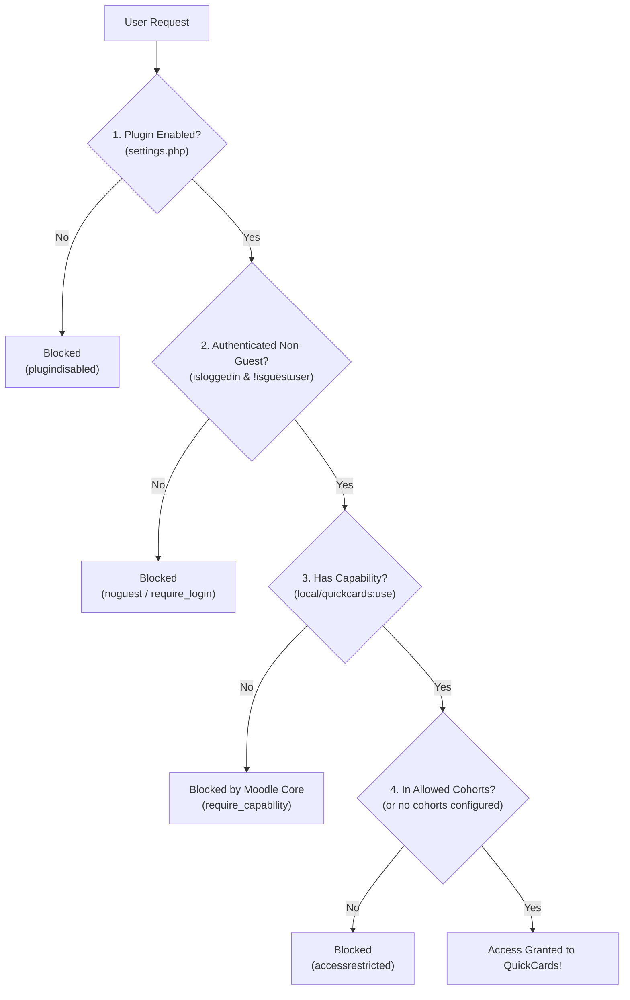

# QuickCards (`local_quickcards`)

QuickCards is a spaced repetition flashcard plugin for Moodle 4.x and 5.x. It enables learners to create, study, and master key concepts using the SuperMemo SM-2 algorithm directly within Moodle.

---

## Key Features

- **SM-2 Spaced Repetition**: Intelligent review intervals based on card recall difficulty (*Again*, *Hard*, *Good*, *Easy*).
- **Deck & Card Organization**: Organize cards into general decks or associate them with specific enrolled courses.
- **Import & Export**:
  - **QuickCards JSON**: Full deck backup with optional SM-2 study progress preservation.
  - **CSV / TSV**: Seamless interoperability with Anki, Quizlet, and spreadsheet editors.
- **Interactive Study Session**: Keyboard shortcuts (`Space` to flip, `1-4` for recall ratings), flip card animations, and auto-scheduling.
- **Deep Moodle Integration**: Linked from the user avatar action menu and custom navigation hooks.

---

## Access Control & Authorization Flow

QuickCards implements a three-tier defense-in-depth model for access control:

### Access Control Layers

1. **Global Site Setting (`local_quickcards/enabled`)**:
   - Master on/off switch managed in *Site administration > Plugins > Local plugins > QuickCards*.
   - When disabled, all endpoints, user action menu items, and AJAX web services are completely blocked.

2. **Guest User Restriction (`isguestuser()`)**:
   - Guest accounts are explicitly forbidden across all web pages (`view.php`, `deck.php`, `study.php`, `export.php`), manager access checks, and web service endpoints with `noguest`.

3. **Moodle Capability (`local/quickcards:use`)**:
   - Standard Moodle role capability defined in `db/access.php`.
   - Allows fine-grained permission assignment by role (e.g., student, authenticated user, custom roles).

4. **Cohort Restriction (`local_quickcards/allowedcohorts`)**:
   - Multi-select setting in *Site administration > Plugins > Local plugins > QuickCards*.
   - **Open by default**: If no cohorts are selected, all permitted authenticated users can access.
   - **Restricted**: If one or more cohorts are selected, only members of those cohorts can access.
   - **Admin bypass**: Site administrators (`is_siteadmin()`) always retain access for testing and maintenance.
